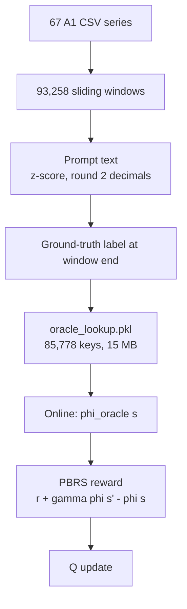
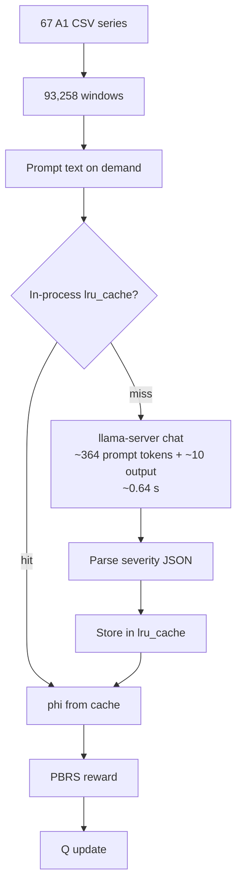
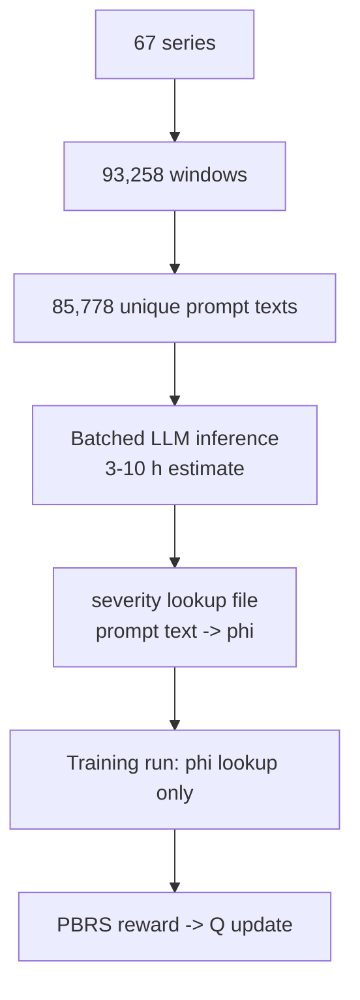

# Oracle vs LLM Judge Flow

Two different kinds of phi. Both static per window. One lookup is cheap. One needs inference.

## Oracle flow



Build cost: seconds. No model. Exact binary severity. All calls hit.

## LLM flow as implemented



Observed: 4,607 unique calls in a mock run. Cache hit returns instantly. Cache cleared at start of each run.

## Precompute LLM flow



## Why they differ

| Item | Oracle | LLM |
| --- | --- | --- |
| Phi source | label lookup | model inference |
| Build cost | seconds | 0.64 s per unique prompt |
| Severity | binary 0/1 | graded JSON |
| Determinism | exact | greedy, stable for fixed model |
| Code support | none; proxy mode | local HF or OpenAI proxy |

Both phi functions depend only on window values. Labels do not change phi. Q-values do not change phi. So precompute is valid.

## Why not precompute LLM values

Not impossible. Tradeoffs:

1. **Coverage waste.** Full A1: 93,258 windows, 85,778 unique prompts. One run queries ~4,607. Precompute all = ~18.6x extra calls.
2. **Cost.** Single stream: 85,778 x 0.64 s = ~15 h. Batched: maybe 3-10 h. Current run LLM time: ~4,600 x 0.64 s = ~49 min, plus training overhead.
3. **Batching limits.** llama-server has 4 slots. 4 GB GPU. KV memory limits parallel prompts. Batch gain uncertain.
4. **Code integration.** `compute_potential.cache_clear()` runs at start. No training script reads a lookup file. `build_phi_lookup.py` exists but is unused, uses wrong default model, and fails on the hidden `.json`.
5. **Version pinning.** Lookup valid only for exact prompt text, model, quantization, chat template, thinking mode, sampling. Any change invalidates it.
6. **Repeat runs.** Precompute wins only across many runs/models. One reproduction run: slower.
7. **No scientific gain.** F1 still limited by 3 episodes, 30 Q updates, epsilon near 1.

## Cache-reuse test after run

Plan: restart llama-server with `--cache-reuse 256`, rerun canary, compare backend latency.

```bash
/home/baptist777/.tmp/tmp.VjJfPBPNr4/env/start_bonsai_server.sh
```

Add flag in script or override:

```bash
--cache-reuse 256
```

Expected gain: prefill reuse from common prompt prefix. Current prefill: 448 ms / 364 tokens. Current cache similarity ~0.56. Gain uncertain.

## Sources of latency

Typical server log:

```text
prompt eval   448 ms / 364 tokens  (812 tok/s)
generation    140 ms /  10 tokens  (64 tok/s)
total         588 ms
```

Proxy overhead: few ms. Mock server: negligible.

So latency is llama.cpp prefill, not the mock/proxy.
